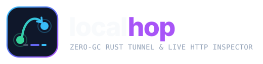

<div align="center">
  <picture>
    <source media="(prefers-color-scheme: dark)" srcset="./assets/logo-dark.svg" />
    <source media="(prefers-color-scheme: light)" srcset="./assets/logo-light.svg" />
    
  </picture>

  <p>
    <strong>Seamless, ultra-low-latency localhost tunnel written in pure Rust — with a built-in live HTTP &amp; webhook inspector and 1-click replay UI.</strong>
  </p>

  <p>
    <a href="https://www.rust-lang.org"></a>
    <a href="https://github.com/tokio-rs/axum"></a>
    <a href="#benchmarks"></a>
    <a href="#benchmarks"></a>
    <a href="#benchmarks"></a>
    <a href="./LICENSE"></a>
  </p>

  <p>
    <a href="#why-localhop">Features</a> &middot;
    <a href="#benchmarks">Benchmarks</a> &middot;
    <a href="#localhop-vs-ngrok-vs-cloudflare-tunnel">Comparison</a> &middot;
    <a href="#quick-start">Quick Start</a> &middot;
    <a href="#architecture">Architecture</a> &middot;
    <a href="#deploy-your-own-relay-for-free">Free Deploy</a> &middot;
    <a href="#cli--server-reference">Reference</a>
  </p>
</div>

---

## Why `localhop`?

Most commercial tunnels enforce monthly request caps, browser interstitial warning pages, or closed-source agents. Meanwhile, most open-source Rust tunnels (`bore`, `rathole`) focus purely on raw TCP forwarding and leave out the developer inspector workflow.

**`localhop`** combines both in two tiny, zero-GC Rust binaries:

- **Sub-Millisecond Proxy Overhead** — Multiplexed binary framing (`9 B` header + raw `bytes::Bytes` chunks) streams HTTP bodies without base64/JSON serialization overhead or garbage-collector pauses.
- **Built-In Live Inspector & Replay (`localhost:4040`)** — Watch incoming requests and webhooks stream live over SSE with pretty-printed JSON, headers, microsecond latency breakdown, **1-click Replay**, **Edit & Replay**, and **Copy as cURL**.
- **Flat Memory Under Load** — Lock-free routing (`DashMap`) + a bounded 200-request ring buffer keep RSS around **~4–7 MB** even after thousands of concurrent requests.
- **$0 Self-Hostable Relay** — Speaks single-port HTTP + WebSocket so you can host your own private relay for free on **Render** (no VPS, no raw TCP/UDP port config, no browser warning page, no request caps).
- **Dual Routing Out of the Box** — Works immediately via path routing (`/t/<id>/...`) with zero DNS setup, or classic wildcard subdomains (`<id>.yourdomain.com`) when you attach a custom domain.

---

## Architecture

<div align="center">
  
</div>

### How the Hot Path Stays Fast
1. **Single Persistent Multiplexed Tunnel:** Concurrent public HTTP requests share one WebSocket connection via `u64` stream IDs (`req_id`)—zero repeated TCP/TLS handshakes per asset or API call.
2. **Zero-Copy Binary Body Frames:** Control headers use compact tagged frames, while streaming request/response body chunks are encoded as `[1B tag][8B req_id][raw Bytes]` with zero string copying or base64 inflation.
3. **Pooled Local Forwarding:** `localhop` maintains a `TCP_NODELAY` keep-alive Hyper HTTP/1.1 connection pool to your local dev server and emits continuous `Ping`/`Pong` RTT telemetry.

---

## Benchmarks

Measured with release binaries (`lto = "thin"`, `strip = true`, `opt-level = 3`) on **Apple M1 (macOS arm64)** running **3,000 HTTP requests at concurrency 32** against a local Axum upstream (`./scripts/bench.sh`):

### Throughput & Tail Latency (Loopback Proxy Overhead)

| Path | Throughput | p50 | p95 | p99 | p99.9 |
| :--- | ---: | ---: | ---: | ---: | ---: |
| **Direct (`localhost:13001`)** | `81,315 req/s` | `0.33 ms` | `0.74 ms` | `1.34 ms` | `1.79 ms` |
| **Through `localhop` (Relay + CLI + Inspector ON)** | **`36,275 req/s`** | **`0.81 ms`** | **`1.51 ms`** | **`1.86 ms`** | **`2.33 ms`** |
| **Net `localhop` Proxy Overhead** | — | **`+0.48 ms`** | **`+0.77 ms`** | **`+0.52 ms`** | **`+0.54 ms`** |

> Notice how flat the tail latency stays: adding `localhop` adds only **+0.48 ms** at median and **+0.54 ms** at **p99.9**—no stop-the-world GC spikes.

### Footprint (Binary Size & Memory RSS)

| Component | Stripped Binary Size | Idle RSS | Post-Load RSS *(3k reqs @ 32c)* |
| :--- | ---: | ---: | ---: |
| **`localhop-server`** *(Axum relay)* | **`2.4 MB`** | `3.9 MB` | `5.6 MB` |
| **`localhop`** *(CLI + embedded Inspector UI)* | **`3.5 MB`** | `4.3 MB` | `6.9 MB` |

### Reproduce on Your Machine

```bash
./scripts/bench.sh
```

---

## `localhop` vs `ngrok` vs Cloudflare Tunnel

> **Methodology note:** `localhop` binary size, RAM, and loopback overhead below are measured directly from this repository (`./scripts/bench.sh`). Figures for `ngrok` and `cloudflared` reflect typical published client footprints and free-tier specifications. Real-world internet RTT always depends on how close your relay/edge PoP is to the caller.

| Feature / Metric | **`localhop`** | **`ngrok`** *(Free)* | **Cloudflare Tunnel (`cloudflared`)** |
| :--- | :--- | :--- | :--- |
| **Language & Runtime** | **Rust (Zero GC)** | Go (Garbage Collected) | Go (Garbage Collected) |
| **CLI Binary Size** | **`3.5 MB`** *(relay: `2.4 MB`)* | ~25 – 40 MB | ~30 – 50 MB |
| **Typical Memory (RSS)** | **`4 – 7 MB`** | ~64 – 128 MB | ~30 – 60 MB *(idle)* |
| **Proxy Added Overhead (p99)** | **`~0.52 ms`** *(loopback)* | Low *(depends on nearest PoP)* | Low *(depends on nearest PoP)* |
| **Built-In Live Inspector & Replay UI** | **Yes (`:4040` SSE + Edit & Replay + cURL)** | Yes (`:4040`) | No *(logs / Zero Trust only)* |
| **Free Monthly Request Limit** | **Unlimited** *(self-hosted)* | 20,000 reqs / mo | Unlimited |
| **Free Monthly Bandwidth** | **Host-dependent** *(no tool cap)* | 1 GB / mo | Unlimited *(HTTP/S)* |
| **Browser Warning / Interstitial Page** | **None** | Yes *(on free tier)* | None |
| **Self-Hostable (Open Source)** | **Yes (MIT, $0 on Render/Docker)** | Proprietary SaaS | Edge requires Cloudflare |
| **Global Anycast Edge (200+ PoPs)** | Bring your own region / VPS | Managed multi-region | **200+ global PoPs** |
| **Best Choice When…** | You want **ultra-low footprint, no caps/warnings, self-hosted control + ngrok-style webhook replay** | You want instant SaaS convenience with zero deployment | You want permanent production exposure behind Cloudflare's global edge |

---

## Quick Start

### Prerequisites
- [Rust toolchain](https://rustup.rs) (`cargo`, stable 1.85+ / Edition 2024)

### Try Locally in 30 Seconds

Open three terminals:

**1. Start the relay server**
```bash
cargo run --release -p localhop-server
```

**2. Start any local dev server on port `3000`** *(skip if you already have one running)*
```bash
python3 -m http.server 3000
```

**3. Open a tunnel**
```bash
cargo run --release -p localhop -- 3000 -s demo
```

You will see:
```text
  localhop v0.1.0
  ────────────────────────────────────────────────────────
  Forwarding   ->  http://127.0.0.1:3000
  Inspector    ->  http://127.0.0.1:4040
  Relay        ->  ws://127.0.0.1:8080/_localhop/ws

  ● LIVE  Public URL  ->  http://127.0.0.1:8080/t/demo
  ────────────────────────────────────────────────────────
  200  GET    /api/hello                    local 0.42ms · total 0.89ms
```

Open **`http://127.0.0.1:4040`** in your browser to inspect every request live, edit headers/body payloads, replay webhooks with one click, or copy any request as `curl`.

---

## Deploy Your Own Relay for Free

### Option 1: Render (Free Tier Blueprint — 1 Click)

This repo includes [`render.yaml`](./render.yaml) and a multi-stage [`Dockerfile`](./Dockerfile):

1. Open [Render](https://render.com) → **New → Blueprint**.
2. Select your `localhop` repository and deploy on the **Free** plan.
3. Point your CLI at your new relay:
   ```bash
   export LOCALHOP_SERVER=https://<your-service>.onrender.com
   localhop 3000
   ```

### Option 2: Docker (Any VPS / Fly / Railway / Homelab)

```bash
docker build -t localhop-server .
docker run -p 8080:8080 \
  -e LOCALHOP_AUTH_TOKEN=my-secret \
  localhop-server
```

### Option 3: Custom Wildcard Subdomains (`*.hop.yourdomain.com`)

Point a wildcard `A` / `CNAME` record (`*.hop.yourdomain.com`) at your relay host and set `LOCALHOP_BASE_DOMAIN`:

```bash
LOCALHOP_BASE_DOMAIN=hop.yourdomain.com localhop-server
```

Tunnels will automatically be issued clean subdomain URLs like `https://myapp.hop.yourdomain.com`.

---

## CLI & Server Reference

### `localhop` (Client CLI)

| Flag / Arg | Env Var | Default | Description |
| :--- | :--- | :--- | :--- |
| `<PORT>` | — | *(required)* | Local port to expose (e.g. `localhop 3000`) |
| `--host <HOST>` | — | `127.0.0.1` | Local host to forward requests to |
| `--server <URL>` | `LOCALHOP_SERVER` | `ws://127.0.0.1:8080` | Public relay URL (`http`/`https`/`ws`/`wss`) |
| `-s, --id <ID>` | — | random 8-char | Request a custom tunnel ID / subdomain (`3–32` chars) |
| `--token <SECRET>` | `LOCALHOP_AUTH_TOKEN` | none | Auth token if your relay requires one |
| `--inspector-port <PORT>` | — | `4040` | Port for the built-in live inspector UI |
| `--no-inspector` | — | `false` | Headless mode (disables local web UI) |

### `localhop-server` (Public Relay)

| Flag | Env Var | Default | Description |
| :--- | :--- | :--- | :--- |
| `--bind <IP>` | `LOCALHOP_BIND` | `0.0.0.0` | Interface address to bind |
| `-p, --port <PORT>` | `PORT` | `8080` | Listening HTTP/WebSocket port |
| `--public-url <URL>` | `LOCALHOP_PUBLIC_URL` | auto-detected | Override inferred public base URL |
| `--base-domain <DOMAIN>` | `LOCALHOP_BASE_DOMAIN` | none | Enable `*.<domain>` subdomain routing |
| `--auth-token <SECRET>` | `LOCALHOP_AUTH_TOKEN` | none | Require token authentication from CLI clients |
| `--timeout-secs <SECS>` | `LOCALHOP_TIMEOUT_SECS` | `60` | Upstream response timeout |

---

## Workspace Layout

```text
localhop/
├── assets/
│   ├── logo-dark.svg          # Adaptive README logo (dark theme)
│   ├── logo-light.svg         # Adaptive README logo (light theme)
│   └── architecture.svg       # System flow diagram
├── crates/
│   ├── localhop-protocol/     # Zero-copy binary frame codec (Bytes)
│   ├── localhop-server/       # Lock-free Axum streaming relay server
│   └── localhop/              # CLI, Hyper keep-alive forwarder, embedded inspector UI
│       └── examples/bench.rs  # Reproducible loopback load & latency benchmark
├── scripts/
│   └── bench.sh               # End-to-end release benchmark runner
├── Dockerfile                 # Multi-stage slim production relay image
└── render.yaml                # Render free-tier Blueprint config
```

## Roadmap

- [ ] Optional **QUIC (`quinn`)** transport (`--quic`) for 0-RTT UDP tunneling on VPS hosts
- [ ] Full **WebSocket passthrough** for proxied local apps (Vite HMR, Next.js Fast Refresh, Socket.IO)
- [ ] **Offline webhook fixtures** — export/import captured requests as JSON and replay without an active tunnel
- [ ] Optional **Ed25519 keypair auth** & multi-tunnel config file (`localhop.toml`)

## License

Released under the [MIT License](./LICENSE).
