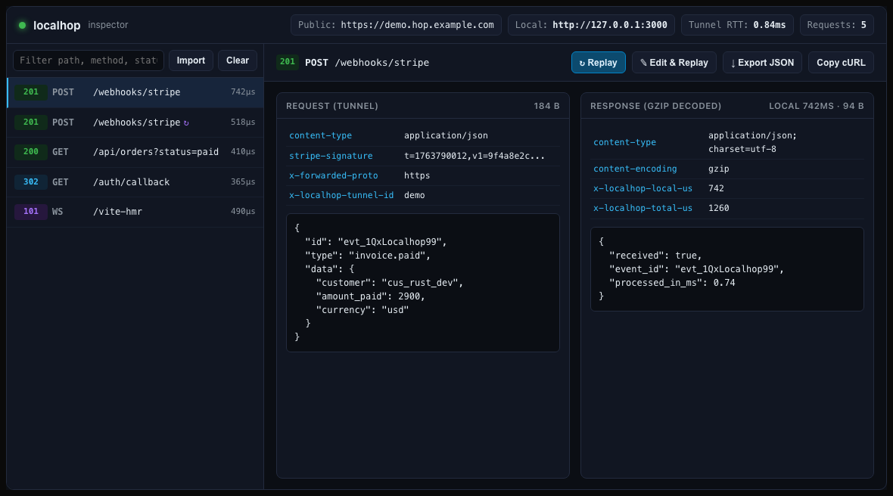
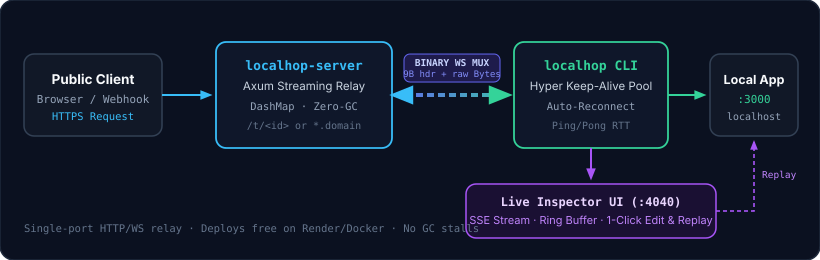

<div align="center">
  <picture>
    <source media="(prefers-color-scheme: dark)" srcset="./assets/logo-dark.svg" />
    <source media="(prefers-color-scheme: light)" srcset="./assets/logo-light.svg" />
    
  </picture>

  <p>
    <strong>Seamless, ultra-low-latency localhost tunnel written in pure Rust — with a built-in live HTTP &amp; webhook inspector and 1-click replay UI.</strong>
  </p>

  <p>
    <a href="https://crates.io/crates/localhop"></a>
    <a href="https://www.npmjs.com/package/localhop"></a>
    <a href="#benchmarks"></a>
    <a href="#benchmarks"></a>
    <a href="#benchmarks"></a>
    <a href="./LICENSE"></a>
  </p>

  <p>
    <a href="https://leon24k.github.io/localhop/">Website</a> &middot;
    <a href="https://leon24k.github.io/localhop/docs/">Docs</a> &middot;
    <a href="#why-localhop">Features</a> &middot;
    <a href="#installation">Install</a> &middot;
    <a href="#benchmarks">Benchmarks</a> &middot;
    <a href="#localhop-vs-ngrok-vs-cloudflare-tunnel">Comparison</a> &middot;
    <a href="#quick-start">Quick Start</a> &middot;
    <a href="#architecture">Architecture</a> &middot;
    <a href="#deploy-your-own-relay-for-free">Free Deploy</a> &middot;
    <a href="#cli--server-reference">Reference</a>
  </p>
</div>

---

## Why `localhop`?

Most commercial tunnels enforce monthly request caps, browser interstitial warning pages, or closed-source agents. Meanwhile, most open-source Rust tunnels (`bore`, `rathole`) focus purely on raw TCP forwarding and leave out the developer inspector workflow.

**`localhop`** combines both in two tiny, zero-GC Rust binaries:

- **Zero-JSON Binary Multiplexing & Single-Frame Fast Path** — Hot-path HTTP headers and small payloads (`<= 16 KiB`) travel in a single compact binary frame (`+0.29 ms` median overhead, `46,919 req/s` loopback) with zero streaming channel allocations on the relay.
- **Built-In Live Chaos & Fault Injection** — Simulate slow networks (`--chaos-delay-ms`, `--chaos-jitter-ms`) and synthetic `503`/`429`/`500` webhook failures (`--chaos-fail-rate`, `--chaos-path`) from the CLI or toggle live inside `:4040` with zero restart and zero overhead when off.
- **Full WebSocket Passthrough** — Works seamlessly with Vite HMR, Next.js Fast Refresh, Socket.IO, and custom WebSocket backends over the same multiplexed tunnel.
- **Built-In Live Inspector & Offline Replay (`localhost:4040`)** — Watch incoming requests and webhooks stream live over SSE with auto `gzip`/`deflate` JSON decoding, **1-click Replay**, **Edit & Replay**, **Export/Import JSON fixtures**, and **Copy as cURL**.
- **Production-Hardened Out of the Box** — Constant-time auth token & `--basic-auth` edge checks, `X-Forwarded-*` proxy headers, configurable body & tunnel caps, zombie tunnel eviction, and localhost CSRF protection on the Inspector API.
- **Flat Memory Under Load** — Lock-free routing (`DashMap`) + a bounded 200-request ring buffer keep RSS around **~4–7 MB** even after thousands of concurrent requests.
- **$0 Self-Hostable Relay** — Speaks single-port HTTP + WebSocket so you can host your own private relay for free on **Render** (no VPS, no raw TCP/UDP port config, no browser warning page, no request caps).

---

## Live Inspector UI (`localhost:4040`)

<div align="center">
  
</div>

- Streams requests and WebSocket upgrades live over Server-Sent Events (SSE)
- Automatically decompresses `gzip` and `deflate` response bodies for readable JSON previews
- Supports 1-click **Replay**, **Edit & Replay**, **Copy as cURL**, and **Export / Import JSON fixtures** for offline webhook testing

---

## Architecture

<div align="center">
  
</div>

### How the Hot Path Stays Fast
1. **Single Persistent Multiplexed Tunnel:** Concurrent public HTTP requests share one WebSocket connection via `u64` stream IDs (`req_id`)—zero repeated TCP/TLS handshakes per asset or API call.
2. **Zero-Copy Binary Body Frames:** Control headers use compact tagged frames, while streaming request/response body chunks are encoded as `[1B tag][8B req_id][raw Bytes]` with zero string copying or base64 inflation.
3. **Pooled Local Forwarding:** `localhop` maintains a `TCP_NODELAY` keep-alive Hyper HTTP/1.1 connection pool to your local dev server and emits continuous `Ping`/`Pong` RTT telemetry.

---

## Benchmarks

Measured with release binaries (`lto = "thin"`, `strip = true`, `opt-level = 3`) on **Apple M1 (macOS arm64)** running **3,000 HTTP requests at concurrency 32** against a local Axum upstream (`./scripts/bench.sh`):

### Throughput & Tail Latency (Loopback Proxy Overhead)

| Path | Throughput | p50 | p95 | p99 | p99.9 |
| :--- | ---: | ---: | ---: | ---: | ---: |
| **Direct (`localhost:13001`)** | `88,279 req/s` | `0.32 ms` | `0.69 ms` | `1.11 ms` | `1.57 ms` |
| **Through `localhop` (Inspector ON)** | **`43,936 req/s`** | **`0.63 ms`** | **`1.42 ms`** | `3.20 ms` | `3.91 ms` |
| **Through `localhop` (`--no-inspector`)** | **`46,919 req/s`** | **`0.61 ms`** | **`1.11 ms`** | `2.90 ms` | `3.63 ms` |
| **Net Median Overhead (`p50`)** | — | **`+0.29 ms`** | **`+0.34 ms`** | — | — |

> Small HTTP requests and responses (`<= 16 KiB`) use `localhop`'s zero-JSON single-frame binary fast path (`RequestInline` / `ResponseInline`) and batched WebSocket writes (`feed` + `flush`), keeping median proxy overhead under **300 microseconds**.

### Footprint (Binary Size & Memory RSS)

| Component | Stripped Binary Size | Idle RSS | Post-Load RSS *(3k reqs @ 32c)* |
| :--- | ---: | ---: | ---: |
| **`localhop-server`** *(Axum relay)* | **`2.6 MB`** | `4.0 MB` | **`5.4 MB`** |
| **`localhop`** *(CLI + Inspector + Chaos + Gzip + TOML)* | **`3.9 MB`** | `4.7 MB` | `7.7 – 8.2 MB` |

### Reproduce on Your Machine

```bash
./scripts/bench.sh
```

---

## `localhop` vs `ngrok` vs Cloudflare Tunnel

> **Methodology note:** `localhop` binary size, RAM, and loopback overhead below are measured directly from this repository (`./scripts/bench.sh`). Figures for `ngrok` and `cloudflared` reflect typical published client footprints and free-tier specifications. Real-world internet RTT always depends on how close your relay/edge PoP is to the caller.

| Feature / Metric | **`localhop`** | **`ngrok`** *(Free)* | **Cloudflare Tunnel (`cloudflared`)** |
| :--- | :--- | :--- | :--- |
| **Language & Runtime** | **Rust (Zero GC)** | Go (Garbage Collected) | Go (Garbage Collected) |
| **CLI Binary Size** | **`3.5 MB`** *(relay: `2.4 MB`)* | ~25 – 40 MB | ~30 – 50 MB |
| **Typical Memory (RSS)** | **`4 – 7 MB`** | ~64 – 128 MB | ~30 – 60 MB *(idle)* |
| **Proxy Added Overhead (p99)** | **`~0.52 ms`** *(loopback)* | Low *(depends on nearest PoP)* | Low *(depends on nearest PoP)* |
| **Built-In Live Inspector & Replay UI** | **Yes (`:4040` SSE + Edit & Replay + cURL)** | Yes (`:4040`) | No *(logs / Zero Trust only)* |
| **Free Monthly Request Limit** | **Unlimited** *(self-hosted)* | 20,000 reqs / mo | Unlimited |
| **Free Monthly Bandwidth** | **Host-dependent** *(no tool cap)* | 1 GB / mo | Unlimited *(HTTP/S)* |
| **Browser Warning / Interstitial Page** | **None** | Yes *(on free tier)* | None |
| **Self-Hostable (Open Source)** | **Yes (MIT, $0 on Render/Docker)** | Proprietary SaaS | Edge requires Cloudflare |
| **Global Anycast Edge (200+ PoPs)** | Bring your own region / VPS | Managed multi-region | **200+ global PoPs** |
| **Best Choice When…** | You want **ultra-low footprint, no caps/warnings, self-hosted control + ngrok-style webhook replay** | You want instant SaaS convenience with zero deployment | You want permanent production exposure behind Cloudflare's global edge |

---

## Installation

### Cargo *(Rust)*
```bash
# From crates.io (once published)
cargo install localhop

# Or directly from GitHub
cargo install --git https://github.com/Leon24k/localhop localhop
```

### npm / npx *(No Rust required)*
```bash
# Run instantly without installing
npx localhop 3000 --server https://<your-relay>.onrender.com

# Or install globally
npm install -g localhop
```

### Shell Installer *(macOS & Linux prebuilt binary)*
```bash
curl -fsSL https://raw.githubusercontent.com/Leon24k/localhop/main/scripts/install.sh | sh
```

---

## Quick Start

### Prerequisites
- [Rust toolchain](https://rustup.rs) (`cargo`, stable 1.85+ / Edition 2024)

### Try Locally in 30 Seconds

Open three terminals:

**1. Start the relay server**
```bash
cargo run --release -p localhop-server
```

**2. Start any local dev server on port `3000`** *(skip if you already have one running)*
```bash
python3 -m http.server 3000
```

**3. Open a tunnel**
```bash
cargo run --release -p localhop -- 3000 -s demo
```

You will see:
```text
  localhop v0.1.0
  ────────────────────────────────────────────────────────
  Forwarding   ->  http://127.0.0.1:3000
  Inspector    ->  http://127.0.0.1:4040
  Relay        ->  ws://127.0.0.1:8080/_localhop/ws

  ● LIVE  Public URL  ->  http://127.0.0.1:8080/t/demo
  ────────────────────────────────────────────────────────
  200  GET    /api/hello                    local 0.42ms · total 0.89ms
```

Open **`http://127.0.0.1:4040`** in your browser to inspect every request live, edit headers/body payloads, replay webhooks with one click, or copy any request as `curl`.

---

## Deploy Your Own Relay for Free

### Option 1: Render (Free Tier Blueprint, 1 Click)

[](https://render.com/deploy?repo=https://github.com/Leon24k/localhop)

This repo includes [`render.yaml`](./render.yaml) (pre-configured with `LOCALHOP_RATE_LIMIT_RPS=100`) and a multi-stage [`Dockerfile`](./Dockerfile):

1. Click **Deploy to Render** above (or open [Render](https://render.com) → **New → Blueprint**).
2. Deploy on the **Free** plan and optionally set `LOCALHOP_AUTH_TOKEN` to lock your private relay.
3. Point your CLI at your new relay:
   ```bash
   export LOCALHOP_SERVER=https://<your-service>.onrender.com
   localhop 3000
   ```

> **Path vs. Subdomain Routing:** Path routing (`/t/<id>/...`) works with zero DNS setup and automatically rewrites relative `Location: /...` redirects. It is ideal for REST APIs and webhooks. For full frontend SPAs (Next.js, Vite) that serve root-absolute assets like `/_next/static/...`, enable wildcard subdomain routing (`LOCALHOP_BASE_DOMAIN`).

### Option 2: Docker (Any VPS / Fly / Railway / Homelab)

```bash
docker build -t localhop-server .
docker run -p 8080:8080 \
  -e LOCALHOP_AUTH_TOKEN=my-secret \
  localhop-server
```

### Option 3: Custom Wildcard Subdomains (`*.hop.yourdomain.com`)

Point a wildcard `A` / `CNAME` record (`*.hop.yourdomain.com`) at your relay host and set `LOCALHOP_BASE_DOMAIN`:

```bash
LOCALHOP_BASE_DOMAIN=hop.yourdomain.com localhop-server
```

Tunnels will automatically be issued clean subdomain URLs like `https://myapp.hop.yourdomain.com`.

---

## CLI & Server Reference

### `localhop` (Client CLI)

| Flag / Arg | Env Var | Default | Description |
| :--- | :--- | :--- | :--- |
| `<PORT>` | — | *(required unless `--config`)* | Local port to expose (e.g. `localhop 3000`) |
| `-c, --config <FILE>` | — | none | Load a multi-tunnel TOML file (see [`localhop.toml.example`](./localhop.toml.example)) |
| `-H, --header <K:V>` | — | none | Inject custom headers into forwarded requests (repeatable) |
| `--host <HOST>` | — | `127.0.0.1` | Local host to forward requests to |
| `--server <URL>` | `LOCALHOP_SERVER` | `ws://127.0.0.1:8080` | Public relay URL (`http`/`https`/`ws`/`wss`) |
| `-s, --id <ID>` | — | random 8-char | Request a custom tunnel ID / subdomain (`3–32` chars) |
| `--token <SECRET>` | `LOCALHOP_AUTH_TOKEN` | none | Auth token if your relay requires one |
| `--basic-auth <U:P>` | `LOCALHOP_BASIC_AUTH` | none | Protect public tunnel URL with HTTP Basic Auth at the edge |
| `--preserve-host` | — | `false` | Forward incoming `Host` header instead of rewriting to `<host>:<port>` |
| `-q, --quiet` | — | `false` | Suppress per-request terminal access logs |
| `--inspector-port <PORT>` | — | `4040` | Port for the built-in live inspector UI |
| `--no-inspector` | — | `false` | Headless mode (disables local web UI) |

### `localhop-server` (Public Relay)

| Flag | Env Var | Default | Description |
| :--- | :--- | :--- | :--- |
| `--bind <IP>` | `LOCALHOP_BIND` | `0.0.0.0` | Interface address to bind |
| `-p, --port <PORT>` | `PORT` | `8080` | Listening HTTP/WebSocket port |
| `--public-url <URL>` | `LOCALHOP_PUBLIC_URL` | auto-detected | Override inferred public base URL |
| `--base-domain <DOMAIN>` | `LOCALHOP_BASE_DOMAIN` | none | Enable `*.<domain>` subdomain routing |
| `--auth-token <SECRET>` | `LOCALHOP_AUTH_TOKEN` | none | Require constant-time token authentication from CLI clients |
| `--timeout-secs <SECS>` | `LOCALHOP_TIMEOUT_SECS` | `60` | Upstream response timeout |
| `--max-tunnels <N>` | `LOCALHOP_MAX_TUNNELS` | `1000` | Maximum simultaneous active tunnels |
| `--max-body-bytes <B>` | `LOCALHOP_MAX_BODY_BYTES` | `52428800` | Maximum HTTP request body size (`50 MiB` default) |
| `--idle-timeout-secs <S>` | `LOCALHOP_IDLE_TIMEOUT_SECS` | `45` | Evict dead/zombie tunnels after idle timeout |
| `--rate-limit-rps <N>` | `LOCALHOP_RATE_LIMIT_RPS` | `0` | Per-IP HTTP rate limit in requests/sec (`0` = unlimited) |

---

## Workspace Layout

```text
localhop/
├── .github/workflows/
│   ├── ci.yml                 # Automated workspace build & test CI
│   └── release.yml            # Cross-platform GitHub Release binaries (macOS/Linux/Windows)
├── assets/
│   ├── logo-dark.svg          # Adaptive README logo (dark theme)
│   ├── logo-light.svg         # Adaptive README logo (light theme)
│   └── architecture.svg       # System flow diagram
├── crates/
│   ├── localhop-protocol/     # Zero-copy binary frame codec (Bytes)
│   ├── localhop-server/       # Lock-free Axum streaming relay server
│   └── localhop/              # CLI, Hyper keep-alive forwarder, embedded inspector UI
│       └── examples/bench.rs  # Reproducible loopback load & latency benchmark
├── npm/localhop/              # Zero-dependency npm/npx binary wrapper
├── scripts/
│   ├── bench.sh               # End-to-end release benchmark runner
│   └── install.sh             # macOS/Linux prebuilt binary installer
├── Dockerfile                 # Multi-stage slim production relay image
└── render.yaml                # Render free-tier Blueprint config
```

## Automated Release Pipeline

1. **Bump version and verify all checks locally:**
   ```bash
   ./scripts/release.sh 0.2.0
   ```
2. **Tag and push** to trigger `.github/workflows/release.yml`:
   ```bash
   git tag -a v0.2.0 -m "Release v0.2.0" && git push origin main v0.2.0
   ```
   The workflow automatically:
   - Builds stripped binaries for macOS (arm64 & x64), Linux (x64 & arm64), and Windows (x64)
   - Generates `SHA256SUMS.txt` and a ready-to-use Homebrew formula (`localhop.rb`) attached to the GitHub Release
   - Publishes all three crates to **crates.io** if `CARGO_REGISTRY_TOKEN` is set in GitHub Repository Secrets
   - Publishes the wrapper to **npm** if `NPM_TOKEN` is set in GitHub Repository Secrets

## Roadmap

- [x] Full **WebSocket passthrough** for proxied local apps (Vite HMR, Next.js Fast Refresh, Socket.IO)
- [x] **Offline webhook fixtures** & automatic **`gzip`/`deflate` body decoding** in the Live Inspector
- [x] Edge **HTTP Basic Auth**, **per-IP rate limiting**, **stream cancellation (`Frame::Cancel`)**, and **multi-tunnel `localhop.toml`**
- [x] Automated **GitHub Release**, **Homebrew formula**, **crates.io**, and **npm** tag pipeline
- [ ] Optional **QUIC (`quinn`)** transport (`--quic`) for 0-RTT UDP tunneling on VPS hosts
- [ ] Optional **Ed25519 keypair auth**

## Security & Contributing

- Security policy & architecture notes: [SECURITY.md](./SECURITY.md)
- Contributing guide: [CONTRIBUTING.md](./CONTRIBUTING.md)
- Release history: [CHANGELOG.md](./CHANGELOG.md)

## License

Released under the [MIT License](./LICENSE).
